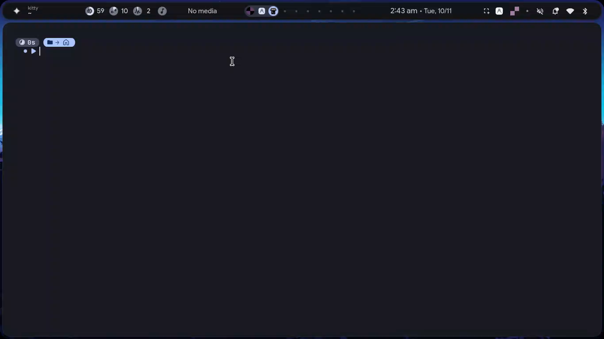
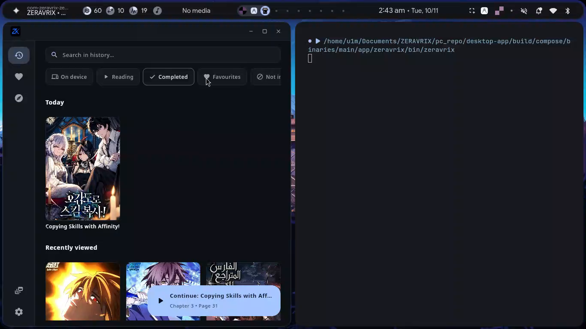

<div align="center">


# ZIBRA (ZERAVRIX Rust Edition)

**A 100% Native Rust Manga, Manhwa & Webtoon Desktop Reader for Windows & Linux**

[](https://zeravrix.pages.dev)
[](https://github.com/U1M/Project-Zibra/releases)
[](#repository-structure)
[](https://www.rust-lang.org/)
[](#repository-structure)
[](LICENSE)

</div>

---

## Overview

**Project ZIBRA** is the complete **100% native Rust** desktop rewrite of **ZERAVRIX-PC**, engineered for ultra-low RAM usage (`< 45 MB` baseline), instant startup (`< 100 ms`), and smooth 60 FPS reading on integrated GPUs across Windows 10/11 and Linux.

### Key Highlights

- **1,647+ Built-In Manga & Manhwa Sources with 18+ / NSFW Filter**:
  - Pre-bundled catalog across **18 languages** (`AR`, `EN`, `MULTI`, `JA`, `KO`, `ZH`, `FR`, `ES`, `PT`, `ID`, `TR`, `RU`, `VI`, `DE`, `IT`, `PL`, `TH`).
  - Built-in **Disable 18+ / NSFW** option (enabled by default) that hides all adult/18+ sources and titles across Explore, Sources Catalog, and Search.
  - Dedicated high-speed engines for **MangaDex API v5**, **MangaSwat** (`meshmanga.com` + `appswat.com` failover), **OlympusStaff / Team-X**, **Azora / ArabToons**, **3asq**, **LekManga**, **Dilar Tube**, **Madara WordPress** (with dual AJAX chapter endpoints), **MangaThemesia / MangaStream**, **ZeistManga / Blogger**, **Universal HTML/CSS Parser**, **Komga / Kavita Servers**, and **Local Folders / `.cbz` Archives**.
- **Kotatsu Material 3 Glassmorphic Desktop UI**:
  - **Top Window Chrome Bar** + **76px Icon Navigation Rail** (`History`, `Favorites`, `Explore` top group; `Feed`, `Downloads`, `Settings` bottom group).
  - **13 Authentic Kotatsu Color Themes**: `Totoro`, `Monet`, `Expressive`, `Miku`, `Asuka`, `Mion`, `Rikka`, `Sakura`, `Mamimi`, `Kanade`, `Itsuka`, `AMOLED Void`, and `High Contrast`.
  - **Shelf & Library Experience**: Search bar, quick filter chips (`On device`, `Reading`, `Completed`, `Favourites`, `Not in favourites`), `Today` / `Yesterday` / `This week` / `Recently viewed` history grouping, `13:18` aspect cover cards with circular reading progress badges, and a **Floating Continue Reading** button.
  - **Landscape Two-Pane Details & Settings**: Split-pane manga details with virtualized chapter list (`show_rows`), live CBZ download progress, and 2-pane settings inspector.
- **Infinite Continuous Multi-Chapter Webtoon & Paged Reader**:
  - **Infinite Chapter Scroll**: Automatically appends and preloads the next chapter as you scroll near the end of the current chapter, with smooth chapter divider banners until the final chapter.
  - Automatic `2048px` vertical strip slicing so long Korean/Arabic webtoon strips never exceed integrated GPU texture limits (`MAX_TEXTURE_SIDE`).
  - Live **Contrast**, **Saturation**, **Brightness**, and **Invert Colors** adjustments, plus multi-Referer anti-hotlink fallback and offline `.cbz` reading.
- **Automatic `~/.zeravrix` Legacy Migration**:
  - Automatically imports your existing `~/.zeravrix/library`, `~/.zeravrix/history`, and `~/.zeravrix/progress` files non-destructively on first launch.

---

## Screenshots

<p align="center">
  
  
</p>

---

## Repository Structure

```text
Project-Zibra-main/
├── Cargo.toml                     # Rust workspace manifest
├── Cargo.lock                     # Locked deterministic dependencies
├── rust-toolchain.toml            # Stable Rust toolchain configuration
├── deny.toml                      # Cargo-deny license & security configuration
├── .gitattributes                 # GitHub Linguist rules (100% Rust badge)
├── .github/workflows/release.yml  # Automated Windows & Linux GitHub Actions CI/CD
├── assets/                        # App icons, branding & raw source properties
│   ├── logo.png
│   ├── logo.ico
│   ├── repository-web-sources.properties
│   └── branding/
├── crates/
│   ├── zibra-core/                # Domain models, 13 Kotatsu themes, SQLite & parallel CBZ downloader
│   ├── zibra-sources/             # 1,647-source catalog, 18+ NSFW filter & HTTP/HTML/API scrapers
│   ├── zibra-reader/              # 2048px strip slicer, cover cache & anti-hotlink loader
│   └── zibra-app/                 # Native eframe/egui desktop UI, infinite reader & glass theme
├── distribution/
│   └── linux/                     # Fedora/RPM spec, .desktop entry & launcher script
├── installer/                     # Windows Inno Setup (.iss) installer & bitmaps
├── packaging/store/               # Windows MSIX Store manifest & packaging scripts
├── docs/                          # Architecture & engineering documentation
└── tools/                         # Icon & native launcher utilities
```

---

## License

Licensed under the **GNU General Public License v3.0** — see [LICENSE](LICENSE) for full details.
