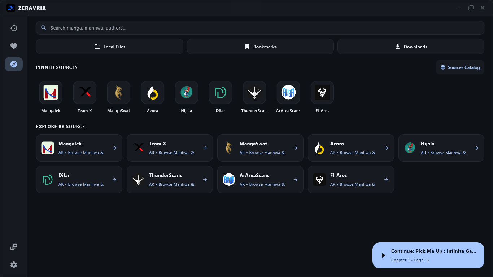
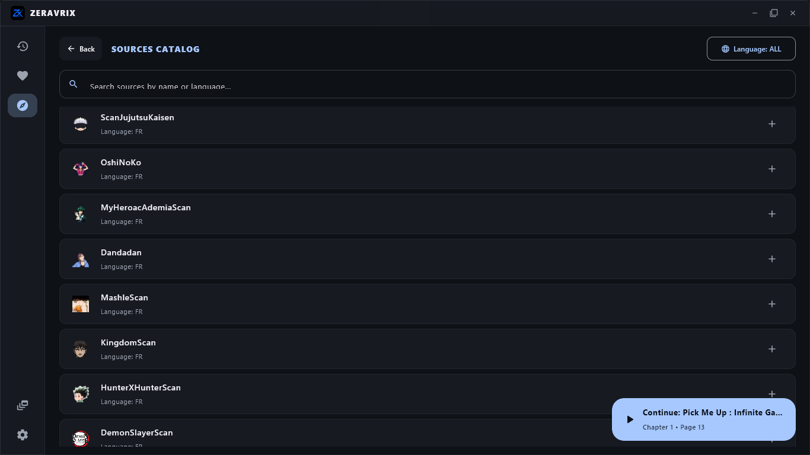
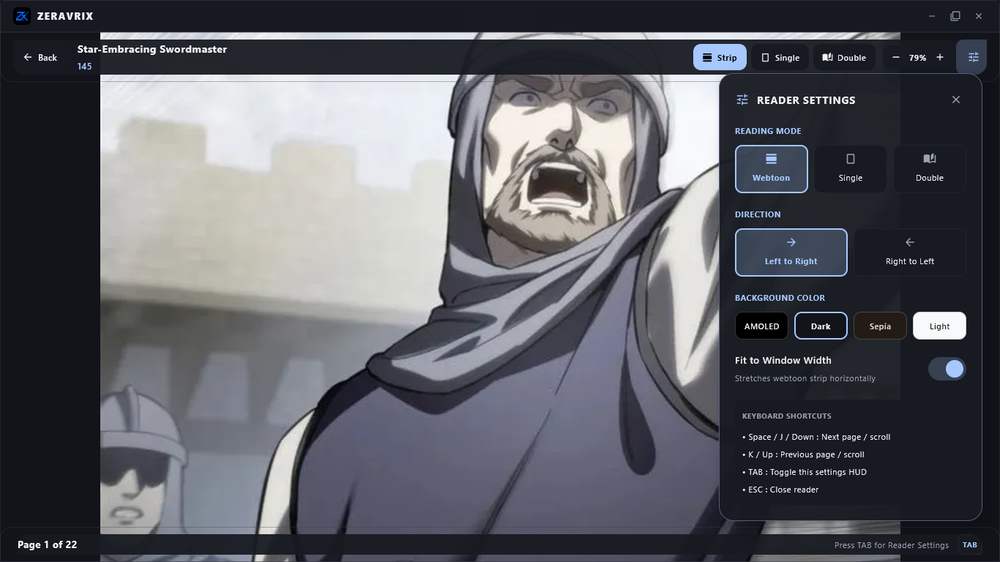
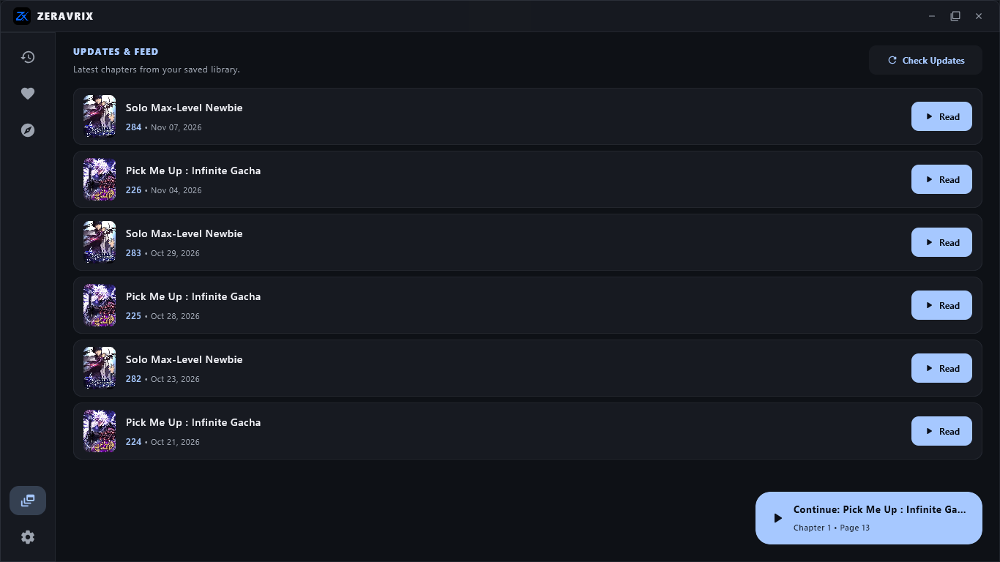
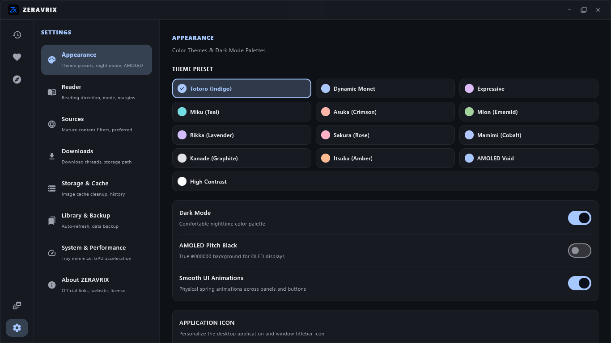

<div align="center">


# ZibraX

**High-Performance Native Manga, Manhwa & Comic Reader for Linux & Windows**

[](https://zeravrix.pages.dev)
[](https://github.com/zeravrix/ZibraX/releases)
[](#downloads--installation)
[](https://www.rust-lang.org/)
[](https://svelte.dev/)
[](LICENSE)

</div>

---

## Overview

**ZibraX** is an ultra-fast, modern native desktop reader engineered for comic, manga, manhwa, and webtoon enthusiasts. Architected with a multi-threaded **Rust core engine** and a sleek **Tauri v2 + Svelte 5** interface, ZibraX delivers instant startup (`< 100 ms`), minimal memory consumption, smooth hardware acceleration, and zero reliance on external JVM or runtime servers.

The application compiles down to a compact standalone native executable with embedded UI assets, running seamlessly out of the box on Linux and Windows.

---

## Screenshots

<div align="center">

### Library & History


<br/><br/>

### Pinned Sources & Global Discovery



<br/><br/>

### Reading Experience & Real-Time Adjustments



<br/><br/>

### Feed & Application Preferences



</div>

---

## Key Features

- **Extensive Multi-Source Catalog**:
  - Access hundreds of working manga, manhwa, and comic sources across multiple languages.
  - Native scrapers for **MangaDex API v5**, **MangaSwat**, **Azora**, **Team-X**, **Dilar**, **Asura Scans**, **Flame Comics**, **Toonily**, personal servers (**Komga / Kavita**), and local archive directories (`.cbz`).
  - Automatic bidirectional archive fallback (Latest ↔ Popular) to ensure maximum title availability.
  - Built-in **NSFW Filter** (configurable in Settings) to safeguard catalog views and search results.

- **In-App Cloudflare Verification**:
  - Integrated lightweight browser window enabling users to pass Cloudflare Turnstile and DDoS-GUARD challenges.
  - Automatic session cookie sync back to the native HTTP client for continuous reading without external browser workarounds.

- **Fast, Modern UI**:
  - Reactive Svelte 5 component hierarchy with smooth transitions, custom accent color palettes, and AMOLED dark themes.
  - Quick library filtering by reading status ("Reading", "Completed") and persistent reading progress tracking across restarts.
  - Compact Feed view displaying the newest chapter releases with direct read links.

- **Continuous Webtoon & Dual-Page Reader**:
  - Continuous vertical reading with intelligent multi-chapter preloading.
  - Dynamic viewport auto-scaling for single-page and 2-page spreads without clipping or aspect ratio distortion.
  - Real-time display adjustments: fit modes, background themes, page gap trimming, and color inversion.

- **Offline Architecture & Storage**:
  - SQLite WAL (Write-Ahead Logging) storage with indexed lookups for reading progress, bookmarks, and history.
  - Built-in parallel download manager and `.cbz` archiver for complete offline access.

---

## Downloads & Installation

### Linux (Standalone Native Binary)

Download the latest Linux release package from [GitHub Releases](https://github.com/zeravrix/ZibraX/releases):

```bash
# Clone or download release archive
tar -xzf zibra-linux-x86_64.tar.gz
cd zibra-linux-x86_64

# Run directly
./zibra-desktop
```

### Windows (Setup & Standalone)

Download the Windows installer (`.exe` / `.msi`) or portable zip from [GitHub Releases](https://github.com/zeravrix/ZibraX/releases), extract, and launch `zibra.exe`.

---

## Building from Source

### Prerequisites
- [Rust toolchain](https://rustup.rs/) (1.80+)
- [Node.js](https://nodejs.org/) (v18+) & `npm`
- Linux dependencies: `libwebkit2gtk-4.1-dev`, `libgtk-3-dev`, `libsoup-3.0-dev`

### Build Steps
```bash
# 1. Clone repository
git clone https://github.com/zeravrix/ZibraX.git
cd ZibraX

# 2. Build frontend assets
npm install
npm run build

# 3. Compile native release binary
cargo build --release -p zibra-desktop

# 4. Binary output
./target/release/zibra-desktop
```

---

## Repository Structure

```text
ZibraX/
├── Cargo.toml                     # Root workspace manifest
├── Cargo.lock                     # Deterministic dependency lockfile
├── index.html                     # Frontend entry point
├── package.json                   # Svelte 5 & Vite configuration
├── vite.config.js                 # Frontend build bundler configuration
├── dist/                          # Bundled webview assets
├── assets/                        # Icons, logos & branding materials
├── docs/assets/                   # High-resolution application screenshots
├── crates/
│   ├── zibra-core/                # SQLite WAL storage, models, settings & parallel downloader
│   ├── zibra-sources/             # Pure Rust source catalog & multi-engine scrapers
│   └── zibra-reader/              # GPU image strip slicer & LRU tile memory cache
├── src/                           # Svelte 5 UI components & state stores
│   ├── lib/
│   │   ├── components/            # CoverCard, CoverGrid, NavRail, SearchBar, ContextMenu
│   │   ├── stores/                # Reactive application state stores
│   │   └── views/                 # Library, Explore, Details, Reader, Settings, About
│   ├── app.css                    # Design system tokens & typography
│   └── main.js                    # UI bootstrap
├── src-tauri/                     # Tauri v2 native bridge & WebKitGTK host
│   ├── Cargo.toml                 # Desktop package configuration
│   ├── tauri.conf.json            # Tauri runtime configuration & window specifications
│   └── src/
│       ├── commands.rs            # Native IPC invocations & Cloudflare solver
│       ├── state.rs               # Thread-safe global application state
│       └── lib.rs                 # Tauri application builder & entry
└── distribution/                  # Packaging specs, desktop entries & launchers
```

---

## License

Licensed under the **GNU General Public License v3.0** — see [LICENSE](LICENSE) for details.
